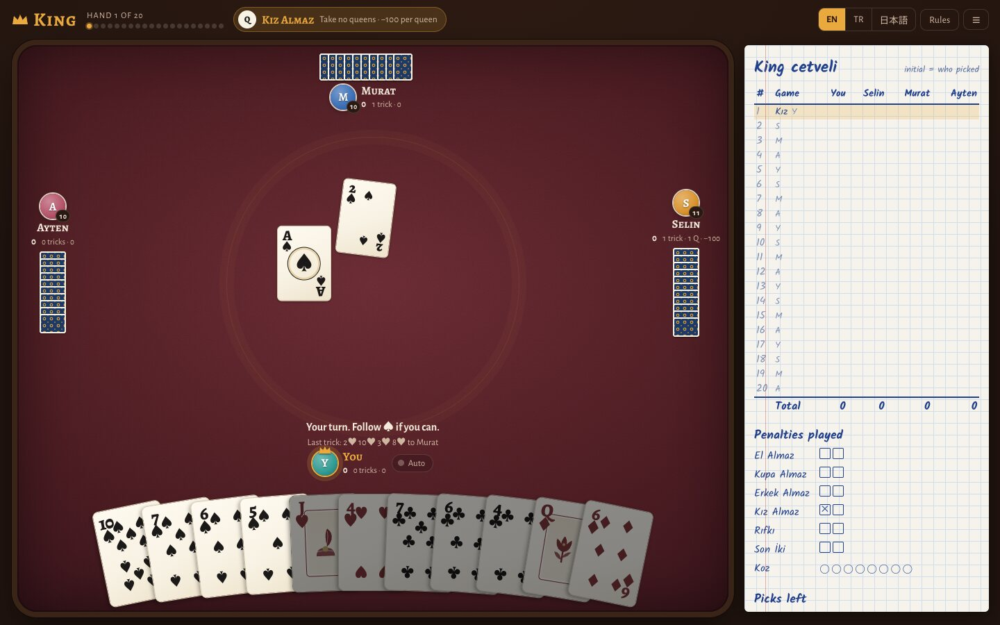
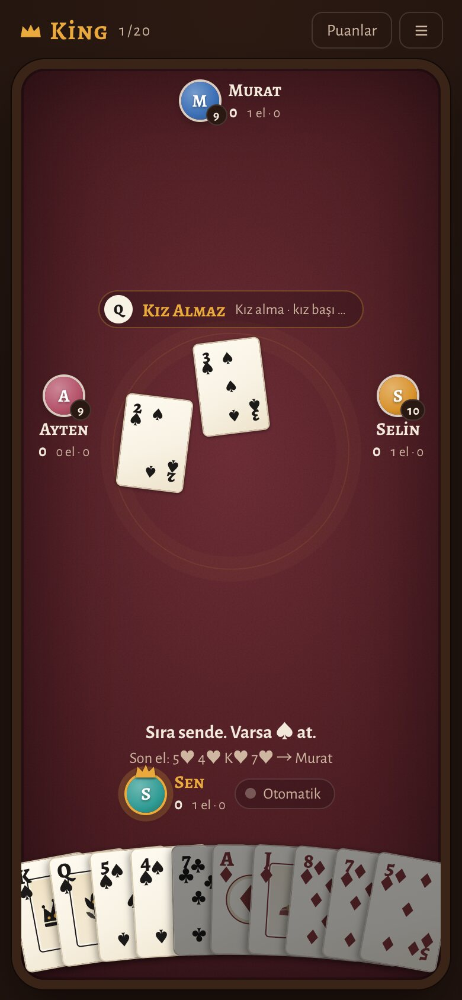
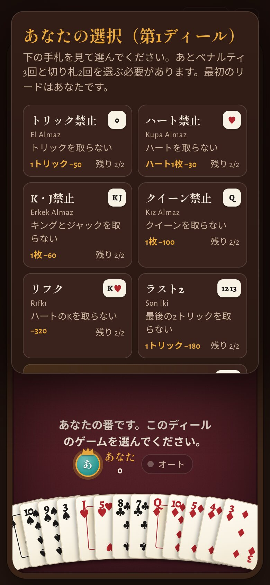

# King

**Play now: [king.arda.tr](https://king.arda.tr)**

King is the Turkish trick-taking card game, played over 20 hands of *cezalar* (penalties)
and *koz* (trumps). This version puts you at the table against three computer players.
It runs in any modern browser, on desktop and phone, in English, Türkçe and 日本語.
It also keeps score when you play King with real cards.



<p align="center">
  
  &nbsp;&nbsp;
  
</p>

## Features

- **The full game.** 20 hands. Each player picks 3 penalty games and 2 trump games, and
  each penalty can be picked at most twice. The rules are enforced: follow suit, dump
  penalty cards when void, no leading hearts or trumps before they are broken, and in koz
  you must beat the highest card or overtrump.
- **Three computer players** who pick their games from the hand they hold and play to avoid
  penalties or to win tricks.
- **Score mode for real tables.** Playing with real cards? Switch to *Score*, enter the four
  players, and the app keeps the King cetveli for you. It moves the pick round the table,
  only offers games the picker may still choose, and checks every hand adds up (13 tricks,
  13 hearts, 8 kings and jacks, 4 queens) before saving. Undo the last hand at any time,
  and share the final results as text.
- **Auto.** The button next to your name plays the rest of the current hand for you,
  including your pick, then switches itself off.
- **English, Turkish and Japanese**, switchable at any time. Turkish uses table words
  (*El Almaz*, *Sıra Murat'ta*). Japanese gives each game a Japanese name with the
  Turkish one underneath.
- **The King cetveli.** A paper-style score sheet shows every hand, ticks off each
  penalty as it is used, and counts the picks each player has left.
- **Made for phones.** Tap a card to raise it and tap again to play it. The score sheet
  is a drawer, and menus slide up from the bottom. Short landscape screens get a compact layout.
- **Installable and offline.** Add it to your home screen and it plays without a
  connection. A game in progress is saved in your browser.

## The games

| Game | Avoid | Points |
|---|---|---|
| El Almaz | any trick | −50 per trick |
| Kupa Almaz | hearts | −30 per heart |
| Erkek Almaz | kings and jacks | −60 per card |
| Kız Almaz | queens | −100 per queen |
| Rıfkı | the king of hearts | −320 |
| Son İki | the last two tricks | −180 per trick |
| Koz | (take tricks, you name trumps) | +50 per trick |

Penalties add up to −5200 over a game and the trump games to +5200, so the four final
scores always sum to zero. King has many house rules. The ones this table uses are on
the in-game **Rules** screen.

## Development

There are no dependencies. Node 18 or newer is enough.

```sh
npm test            # 300 bot games and 300 score-mode tables: legal, zero-sum, quotas met; all translations present
npm run build       # write the static site to dist/
npm run serve       # build, then serve dist/ on http://localhost:8417
npm run screenshots # retake docs/*.jpg with headless Chrome (needs npm run serve running)
npm run icons       # re-render the PNG icons and og.png from the SVGs (needs rsvg-convert)
```

| Path | What it is |
|---|---|
| `src/game.html` | The whole game: rules engine, bots, translations and UI in one file. It is a page body, so it can also be published as a Claude artifact unchanged. |
| `public/` | Copied into the site as is: web manifest, service worker, icons, `og.png`, `CNAME`, `robots.txt`. |
| `tools/build.mjs` | Wraps `src/game.html` in a full HTML document (meta tags, manifest, service worker) and writes `dist/`. |
| `tools/selftest.mjs` | The engine and translation checks behind `npm test`. |
| `tools/screenshots.mjs` | Drives headless Chrome over the DevTools protocol to take the README images. |

The rules live between `/*ENGINE-START*/` and `/*ENGINE-END*/` in `src/game.html`, and
the strings between `/*I18N-START*/` and `/*I18N-END*/`. Run `npm test` after changing
either one. A language missing a string fails the test.

## Deployment

The site is hosted on GitHub Pages at **https://king.arda.tr**. Every push to `main`
runs [`.github/workflows/pages.yml`](.github/workflows/pages.yml): the tests, then the
build, then the deploy. Nothing else is needed.

- DNS: `king.arda.tr` is a CNAME to `c0ze.github.io`.
- Pages is set to build from GitHub Actions, with custom domain `king.arda.tr` and
  HTTPS enforced.
- The service worker serves pages network-first, so players get a new deploy on their
  next visit and the cached copy when they are offline.

To host it anywhere else, run `npm run build` and upload `dist/`. Serve `index.html` and
`sw.js` with `Cache-Control: no-cache`. The service worker needs HTTPS.
